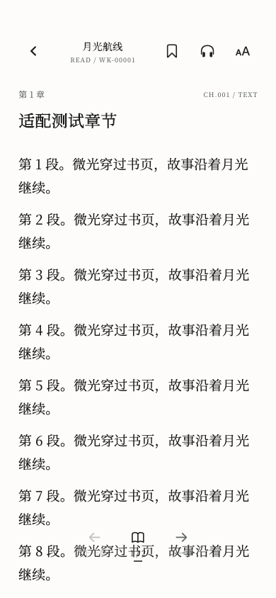
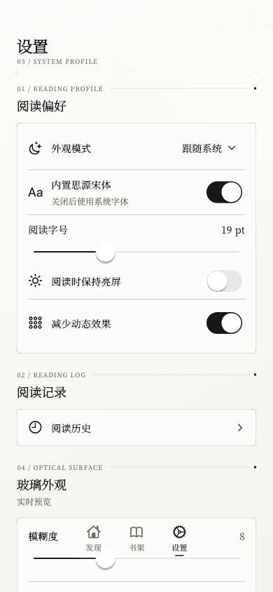

<p align="center">
  
</p>

<h1 align="center">Wenku8 Flutter</h1>

<p align="center">基于 Flutter 的 Android 轻小说阅读客户端</p>

<p align="center">
  <a href="https://github.com/mikufoxxx/Wenku8_Flutter/releases"></a>
  <a href="https://github.com/mikufoxxx/Wenku8_Flutter/actions/workflows/flutter-ci.yml"></a>
  
  <a href="assets/licenses/GPL-3.0.txt"></a>
</p>

<p align="center">
  <a href="https://github.com/mikufoxxx/Wenku8_Flutter/releases">下载</a> ·
  <a href="CHANGELOG.md">更新日志</a> ·
  <a href="https://github.com/mikufoxxx/Wenku8_Flutter/issues">问题反馈</a> ·
  <a href="docs/RELEASING.md">构建指南</a>
</p>

## 简介

Wenku8 Flutter 是轻小说文库客户端的 Flutter 重构版本，面向 Android，集成书籍发现、书架管理、阅读、离线缓存与在线听书。界面采用半透明材质与档案式排版，提供立体书架、连贯的页面过渡和可自定义的阅读体验。

## 界面预览

<p align="center">
  
  &nbsp;
  
  &nbsp;
  
</p>

## 功能特性

- **书籍发现**：分类、排行、书名与作者搜索（匿名使用，无需账号）。
- **立体书架**：循环轮播、惯性滚动、吸附定位与触觉反馈。
- **阅读排版**：字号、行距、深浅主题、系统字体与内置思源宋体，支持实时预览。
- **阅读工具**：章节目录、书签定位与高亮、章内查找、插图查看与分享。
- **离线阅读**：章节缓存、缓存管理、阅读历史、进度续读与本地备份。
- **在线听书**：中文音色、语速调节、段落跟随、睡眠定时、后台与锁屏控制。
- **纯本机数据**：无账号体系，所有收藏、进度与缓存仅保存在本机，可通过本地备份迁移。
- **本地书库**：选择文件夹，扫描导入 TXT / PDF；TXT 自动识别 UTF-8 / GB18030 编码并切分章节，PDF 逐页渲染阅读；新书自动上架，启动时静默自动扫描。
- **标签与整理**：自建标签库，给任意书打标签并在书架按标签筛选；详情页可编辑标签，设置页可管理标签。
- **随机选书**：书架一键随机抽一本，附带"换一本"。
- **信息修正**：本地书可在书库管理页手动修正书名/作者。
- **性能设置**：低性能设备模式，可独立调整玻璃折射、模糊、动效与立体书架。

## 下载

从 [GitHub Releases](https://github.com/mikufoxxx/Wenku8_Flutter/releases) 下载 APK。提供 `arm64-v8a`、`armeabi-v7a` 与 `x86_64` 三种架构，常见 Android 手机请选择 **arm64-v8a**。

安装后，可在 **设置 → 关于轻小说文库** 查看版本信息、更新说明并检查更新。

## 构建

开发环境：**Flutter 3.41.5 / Dart 3.11.3、JDK 17、Android SDK**。

```sh
git clone https://github.com/mikufoxxx/Wenku8_Flutter.git
cd Wenku8_Flutter
flutter pub get
flutter build apk --release --target-platform android-arm64
```

### GitHub Actions

- [Flutter Android](https://github.com/mikufoxxx/Wenku8_Flutter/actions/workflows/flutter-ci.yml)：代码检查、自动测试与 ARM64 APK 构建。
- [Build Android APKs](https://github.com/mikufoxxx/Wenku8_Flutter/actions/workflows/android-release.yml)：三架构签名 APK、源码归档与版本发布候选，支持版本标签触发和手动运行。

签名配置与发布流程见 [构建发布指南](docs/RELEASING.md)。

## 贡献

欢迎通过 [Issues](https://github.com/mikufoxxx/Wenku8_Flutter/issues) 反馈问题或提出建议，通过 Pull Request 参与开发。提交问题时请提供应用版本、Android 版本和复现步骤。

## 致谢与许可

本项目基于 [MewX/light-novel-library_Wenku8_Android](https://github.com/MewX/light-novel-library_Wenku8_Android) 重构。感谢 MewX、Baby Pepper（SeraphRoy）、Jack Liu（aaassseee）及原项目贡献者。

- 应用源码：保留原项目 [GPL v2 或后续版本声明](LICENSE)，本 Flutter 组合版本按 [GPL v3](assets/licenses/GPL-3.0.txt) 分发。
- 内置字体：[Adobe Source Han Serif CN](https://github.com/adobe-fonts/source-han-serif)，[SIL OFL 1.1](assets/fonts/OFL-SourceHanSerif.txt)。
- 在线语音协议适配：[rany2/edge-tts](https://github.com/rany2/edge-tts)，[LGPL v3](assets/licenses/edge-tts.txt)。

完整版权声明与接口运行库分发条件见 [NOTICE](NOTICE) 和 [第三方组件许可](docs/THIRD_PARTY.md)。
